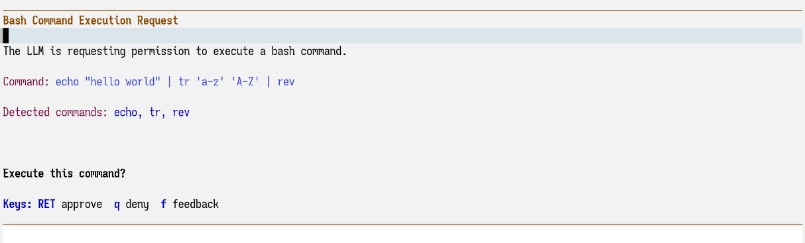
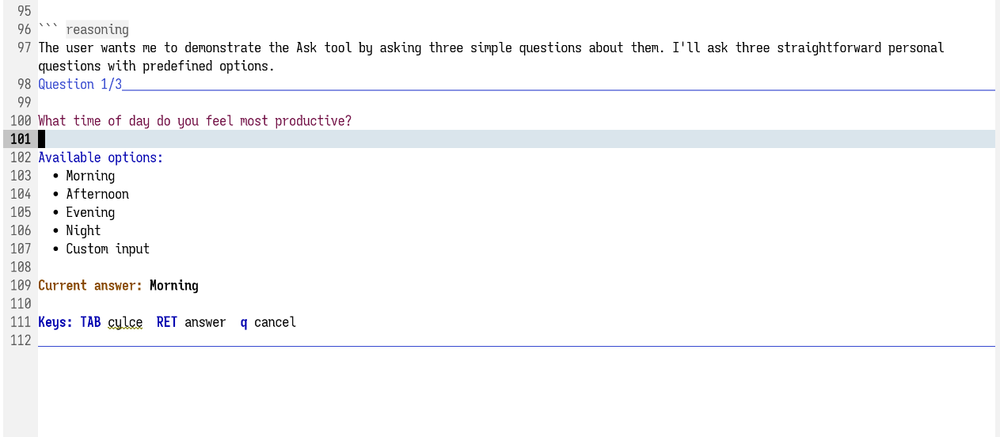
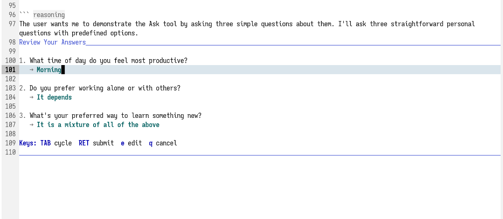
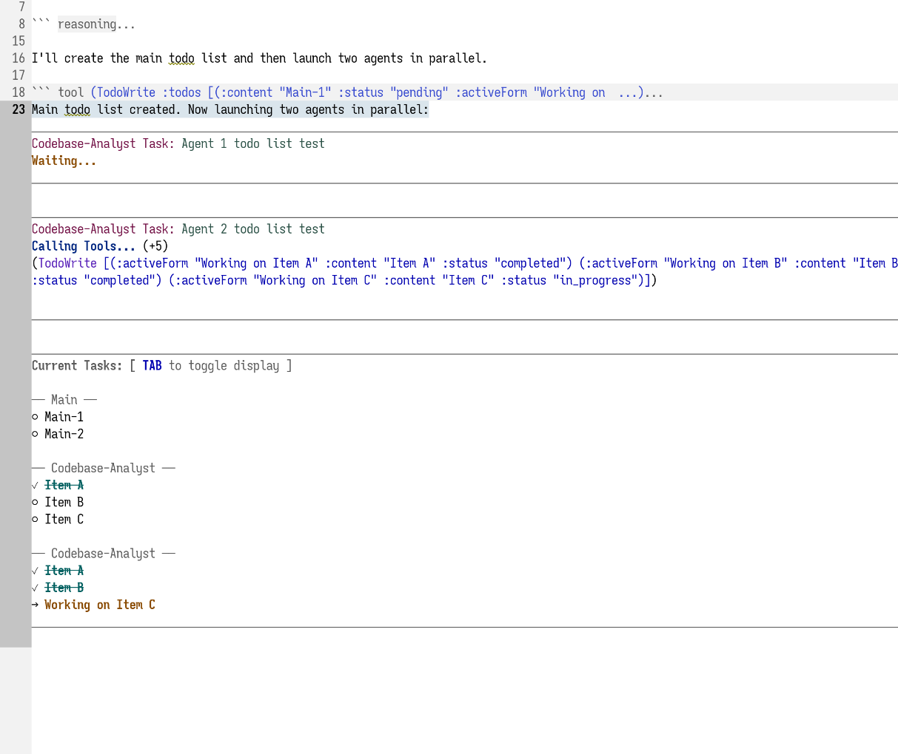
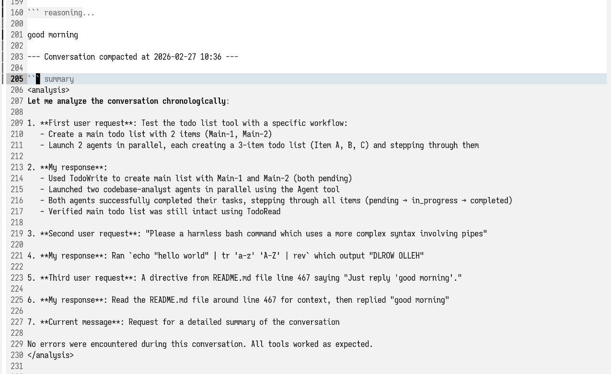
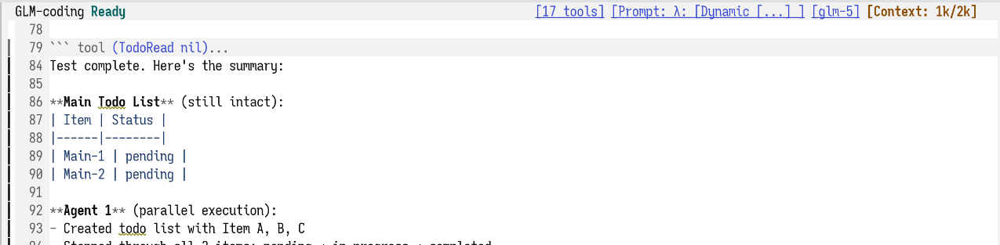

# mevedel

*mevedel* is an Emacs LLM workflow package, originally inspired by `evedel`,
now focused on chat sessions, notes, tool use, agents, and
persistent project context. It is built on
[gptel](https://github.com/karthink/gptel), is versatile enough so that it can
be utilized in various types of buffers, and isn't limited to just programming
buffers.

> [!WARNING]
> `mevedel` uses a lot of tokens. Consider using a model which allows caching.

> [!WARNING]
> The package is functional but still work in progress. Expect missing features, unexpected behavior and bugs.

## What does this package do?

`mevedel` began as a fork of the Emacs package
[evedel](https://github.com/daedsidog/evedel), building on its overlay-based
instruction model and integrating it with
[gptel](https://github.com/karthink/gptel) for direct LLM interaction. It has
since grown into an independent LLM workbench for Emacs, while still giving
credit to the original `evedel` idea.

Key features:

- Uses [gptel](https://github.com/karthink/gptel) for LLM integration with
  support for multiple backends.
- Uses overlays for tracking notes without inserting comments into source.
  Notes follow edits and persist in the workspace across sessions.
- Can categorize your notes with tags, and use tag query expressions in
  `@note:{query}` mentions to choose which notes to attach to a chat.
- Can cycle through note overlays across buffers.
- Retained asynchronous child agents plus focused explorer, verifier, and
  reviewer workflows using mevedel’s agent runtime.
- Durable Goals (say "Create a goal for..." or use `/goal <objective>`) that
  keep one objective in every root turn and continue automatically while idle.
- Skills (`SKILL.md` packages) for reusable `$skill` commands and prompt bundles,
  scanned from user / project / bundled directories.
- Persistent sessions per workspace with resume, true in-place Rewind,
  Conversation and Worktree Forks, and workspace input history.
- SSH, Docker, and Podman project workspaces through Emacs TRAMP, with tools,
  processes, hooks, sandboxing, and session state kept on one execution target.
- Interactive inline diff previews with approve/reject/edit workflow directly in
  the chat view.
- Unified permission system covering Bash, file paths, web domains, and
  sub-agent dispatch, with `ask` / `edits` / `full-auto` modes.
- Project and user hooks for prompt, permission, tool, compaction, turn, and
  sub-agent lifecycle automation.
- Conversation compaction that rotates segments rather than mutating the live
  buffer, so older turns stay browsable on disk.
- Persistent memory (`.mevedel/memory/` and `.agents/memory/`) and project
  instruction files (`AGENTS.md`) for customizing LLM behavior.
- `@note`, `@file`, `@agent`, and `@mcp` mention syntax in chat buffers.

[output.webm](https://github.com/user-attachments/assets/738c9f8e-2798-466c-875e-5a77bc166a56)

## Requirements

- A Linux host.  Portable session storage needs procfs, GNU `stat`, and
  `bash`, and refuses to run anywhere else; CI covers Linux only.  On a
  remote target, optional compression makes each storage round trip cheaper
  when `gzip` is available both locally and on the target; otherwise the
  program script travels inline.
- Emacs version 31.1 or higher
- [gptel](https://github.com/karthink/gptel) 0.9.9.6 or higher
- [acp.el](https://github.com/xenodium/acp.el) 0.15.2 or higher for external agent connections
- [yaml](https://github.com/zkry/yaml.el) 1.2.0 or higher for skill frontmatter
- [orderless](https://github.com/oantolin/orderless) 1.1 or higher for Emacs symbol completion
- [websocket](https://elpa.gnu.org/packages/websocket.html) 1.15 for
  browser collaboration (the self-hosted relay lives in `relay/`)
- [ripgrep](https://github.com/BurntSushi/ripgrep) for search tools and `@file`
  directory listings
- [Bubblewrap](https://github.com/containers/bubblewrap) on Linux for Bash and
  fresh Eval child confinement
- Python 3 for safely opening and writing authorized file-tool paths
- Optional: a kernel with Landlock ABI 9 or newer, to keep
  confined commands away from host Unix sockets without an exact exception
- Optional: [mcp.el](https://github.com/lizqwerscott/mcp.el) for `@mcp` mentions
- Optional: Poppler (`pdftoppm`) for rendering selected PDF pages with `Read`
- Optional: Node 22.4 or newer on the Emacs host for
  [shared whiteboard and document editing](docs/shared-editing.md) in browser rooms
- Optional: ImageMagick (`magick` or `convert`) for image/PDF resize and
  compression options in `Read`

Remote Linux targets require `rg`, `bash`, `setsid`, and `python3`.  Git is
required only for Git-backed workflows, Bubblewrap follows the configured
sandbox mode, and media converters remain optional.  Mevedel probes these
capabilities but does not install target dependencies.

On a remote workspace, another package doing remote I/O from a process
sentinel can interrupt a mevedel command mid-conversation; TRAMP then refuses
the nested call and you see `Forbidden reentrant call of Tramp`.  Mevedel
holds off its own work while the connection is busy, but it cannot hold off
anybody else's.  Projectile is the one worth stopping, because it advises
`delete-file` and so triggers on every temporary file any sentinel deletes —
see [Transport reentrancy](docs/sessions.md#transport-reentrancy) for a
three-line advice that declines to run inside a remote operation.

## Installation and configuration

The package is not available on MELPA but you can install it directly from
Github using [straight.el](https://github.com/radian-software/straight.el).

``` emacs-lisp
(straight-use-package
 '(mevedel :host github
           :repo "FrauH0lle/mevedel"
           :files ("*.el"
                   ("native" "native/*.c" "native/*.eld")
                   ("scripts" "scripts/mevedel-mcp-stdio.py")
                   "agents"
                   "prompts"
                   "skills"
                   ("shared-editing"
                    "shared-editing/host.bundle.mjs"
                    "shared-editing/resvg.wasm"
                    "shared-editing/font.ttf"
                    "shared-editing/Excalifont.ttf"
                    "shared-editing/Nunito.ttf"
                    "shared-editing/ComicShanns.ttf"
                    "shared-editing/builtin.excalidrawlib"
                    "shared-editing/FONT-LICENSE"
                    "shared-editing/RESVG-LICENSE"
                    "shared-editing/THIRD-PARTY-NOTICES.txt")
                   "docs/*.md"
                   "docs/adr/*.md"
                   "docs/agents/*.md"
                   "tools")))

(use-package mevedel
  :after gptel
  :config
  (mevedel-install))
```

`mevedel-install` is an interactive command and should be run when changing
installation-dependent custom variables. Spinner options refresh active views
when applied through Customize; they do not require reinstalling or restarting
a request.

Run `mevedel-uninstall` to deactivate `mevedel`.

To keep global user state somewhere other than `~/.mevedel/`, set
`mevedel-user-dir` before mevedel loads, for example with `:custom` (or a
`setq` in `:init`). The defaults of `mevedel-skill-dirs` and
`mevedel-memory-dirs` are computed from it at load time; a later change
does not move them.

``` emacs-lisp
(use-package mevedel
  :after gptel
  :custom
  (mevedel-user-dir (expand-file-name "mevedel/" user-emacs-directory))
  :config
  (mevedel-install))
```

### Claude Pro/Max subscriptions

Install the unmodified Claude CLI using its
[official instructions](https://code.claude.com/docs/en/setup) and run
`claude auth login` in a terminal with your Claude Pro or Max account (Team and
Enterprise logins also work). Then run `M-x mevedel-claude-code-setup`: it
checks Claude Code 2.1.293+, Node.js 22+, Python 3.8+, acp.el 0.15.2+ and the
subscription login without starting a model request. Subscription selection
rejects API authentication and does not enable paid overflow.

When Claude Code exposes the subscription login's hard expiry in its local
credentials file, Mevedel warns once per expiry at session or turn startup.
Set `mevedel-claude-code-login-warning-days` to change Mevedel's three-day
lead time, or to nil to disable advance warnings. After expiry, sign in again
with `claude auth login` before retrying, including when a context summary fails.
Mevedel does not extract or cache tokens, and does not warn if expiry metadata
is unavailable.

Mevedel keeps the native CLI on its own configured release channel
(`autoUpdatesChannel`, `latest` by default) and the managed ACP adapter on its
latest release.
A Claude launch starts a background check when one is due (daily, hourly after
a failure). A new runtime is selected only after its versions and ACP handshake
pass; running invocations keep their executables, and a failed check keeps the
previous runtime. **Install/update adapter** in the setup buffer, or
`M-x mevedel-claude-code-install-adapter`, checks now and reports progress and
the result in the echo area; it refuses while another check holds the
installation lock. Set `mevedel-claude-code-auto-update` to nil to disable
automatic checks. Package-manager CLI binaries and a custom
`mevedel-claude-code-adapter-executable` are validated, never replaced. Keep
`mevedel-claude-code-directory` stable: it holds the managed runtimes and the
conversation directory used for resume. Claude runs on the Emacs host, also for
remote project tools.

Adapter diagnostic logs default to `~/.mevedel/claude-agent-logs` on the Emacs
host. Customize `mevedel-claude-code-agent-log-directory` to change the directory,
or set it to nil to stop mevedel from enabling logging. Mevedel expands the path
and sets `CLAUDE_AGENT_LOGS` only in the adapter's launch environment; an inherited
value (even an empty string) always wins, including when the option is nil.
After an adapter crash, check this directory for diagnostics. Changes apply to
new adapter processes, not already running conversations.

Select `Claude Code:sonnet`, `Claude Code:opus`, `Claude Code:fable` or
`Claude Code:haiku` in a session's model menu. Mevedel supplies its tools over
MCP; no API key or MCP configuration is needed. Use mevedel's model and tools
menus; gptel's HTTP request-controls menu is unavailable. The model picker also
switches an existing root conversation between Claude Code and an API provider.
If Claude's native history is missing or diverged,
`M-x mevedel-claude-code-recover-history` continues from a labelled transcript
excerpt. In the collaboration browser, owners repair these through **Recovery**.
Read [session lifecycle and restrictions](docs/sessions.md#external-conversation-references)
before using Fork, Rewind or Save As with this provider.

## Usage

mevedel’s function revolves around chat sessions and notes within your Emacs
buffers. Notes mark code with optional text that you send or mention when you
want the model to see it.

The video at the [beginning](#what-does-this-package-do) of this README should
give you a good impression on the usage.

You can send your requests to the LLM either via the chat buffer (accessible by
using `mevedel`) or by sending a note into its own conversation.

### Quick start

1. Configure a gptel backend or follow [Claude subscription setup](#claude-promax-subscriptions).
2. Install the package and run `M-x mevedel-install`.
3. Open a project and run `M-x mevedel` to create or resume a chat session.
   For remote work: visit remote/container directory → `M-x mevedel`.
4. Type in the composer at the bottom of the view; use `/help` for local slash
   commands.
5. Run `/init` or `M-x mevedel-init` to bootstrap or improve project guidance.
6. Use `/goal <objective>` for durable automatic continuation toward one
   objective.
7. Use `/review` or `/verify` to inspect changes before committing.

### Workflow map

The rest of this README is intentionally manual-style. The main moving parts are:

- Workspaces define the project root, allowed directories, session storage, and
  project-local context.
- Notes provide the overlay-based workflow for attaching comments to ordinary
  buffers.
- The chat view provides the interactive gptel-backed workbench for ongoing
  conversations, tool calls, permissions, previews, agents, and slash commands.
- Tools, permissions, inline previews, hooks, skills, agents, sessions,
  compaction, memory, and `@` mentions are documented below, with deeper design
  notes linked from [Documentation](#documentation).

### Notes

A note is a marked code range with optional text, created by you or the agent
(or as a Buddy remark). Use `M-x mevedel-note-create` in a visited source file
to mark the active region, or the current line when no region is active. The
text is optional: submitting an empty answer keeps a code-only note. A label
is collapsed by default (`mevedel-note-labels` is `collapsed`): a single line
shows `▍ Note N · You  note text` (or `AI` / `Buddy`), cut with `…` at 80
columns or the space left after indentation and bar, whichever is smaller.
Expanded labels sit below the complete source line at the code's indentation.
The bar and header use the author's label face; the full note text uses the
normal face, filled to `fill-column` bounded by the window width. Each
continuation line starts with the bar; Buddy remarks use `┆` instead.
Whole-line notes tint to the window edge; partial selections tint only their
marked text. Expanded label rows remain untinted. Only states needing
attention appear after the header, dimmed: `change ready`, `change stale`,
`working…`, `Buddy watches`, `looks done`, or `paused` for a paused take.
Labels show neither sent/unsent status nor menu instructions.
Set `mevedel-note-labels` to `expanded` to show the full wrapped text initially.
Nested labels stack below their source lines; the inner note's tint wins on
overlapping code. Both identities appear in the entry hint.
Notes follow source edits. A note is unsent, sent, taken or closed (done,
deleted or dismissed). Its context reaches a prompt only when you send or
mention it.

Inside a note, `M-m` (or `mevedel-ov-dispatch-key`) opens an inline **Actions** row.
Overlapping notes offer their number, author and first text line even when
their labels are collapsed.
Its keys are `s` send/reopen, `p` preview prompt, `t` take/drop, `i` edit, `g` tags, `x` done,
`k` delete/dismiss, `b` keep a Buddy remark, `w` copy text, `S` settings and
`e` expand/collapse. `a` apply and `m` merge appear only for a prepared change;
`r` revert appears only for applied changes. Plain letters still insert source
text outside the menu; entering a note shows an echo-area hint even when collapsed.
`M-x mevedel-notes-toggle-labels` expands all notes in the current buffer
if any are collapsed; otherwise it collapses them all. Display state belongs
to each live overlay and is not persisted. Moving point never changes style.
`mevedel-note-edit`, `mevedel-note-delete`, and
`mevedel-note-menu` are available through `M-x` too. Deleting a note never edits
its source code. Creating or editing a note does not send anything to a model.

Choose **preview** to inspect the exact prompt that sending would build, without
starting a conversation or contacting a model. Choose **send** in that menu,
or use `M-x mevedel-note-send`, to open the note's
own conversation beside the code. Graphical Emacs uses an anchored child frame;
terminal Emacs uses a side window. Type below the prompt and press `C-c C-c`
to reply. The transcript above is read-only. `C-c C-v` shows retained provider
inputs, including instructions and tool definitions. A hint above the prompt
shows `C-c C-z close`, plus `C-c C-a apply · C-c C-g merge` while a change waits.
Closing leaves the conversation and draft alive. Sending a sent note
reopens its conversation without making another request.

Source-file ApplyPatch changes in a note conversation wait as **change ready**;
they do not write source or keep the AI's turn open. `C-c C-a` applies the waiting
change as one source undo step. `C-u C-c C-a` opens the existing detailed patch
review; confirming a partial selection drops the unselected rest. A newer
proposal replaces the waiting one, while earlier proposals remain in the
conversation. Applying closes every note included in that conversation as done;
notes excluded because they have their own conversation stay open.

An overlapping source edit makes apply refuse and shows **change stale**.
Continue in the ordinary composer to request a revised change, or use
`C-c C-g` to open a separate three-way smerge editor. Resolve there, then use
`C-c C-c` to confirm or `C-c C-k` to cancel. Confirmation refuses if the source
changed again; generated conflict markers never go into the source. Merging
uses local `git merge-file` on temporary copies, also outside Git repositories.
Missing local Git gives a clear refusal. Resource-address patches keep their
ordinary ApplyPatch behavior rather than becoming prepared source changes.

Use **revert** in the note menu, or `C-c C-b` at the note or in its conversation,
to reverse one applied turn without Rewind. Choose a turn if several changed
files. Revert preserves disjoint later edits and refuses with file/line ranges
if the changed lines were edited again; save or undo unsaved source edits first.
`M-x mevedel-note-revert-change` also offers recently closed notes when invoked
away from a note. A successful revert reopens a done note; deleting a note never
reverts its code changes.

`M-x mevedel-note-send-batch` sends several loaded notes into one conversation.
Sending a note includes all descendants, at every depth, without duplicating
their code. Sending a child does not include its parent. A descendant with its
own conversation is named but excluded together with its subtree. Batch send
deduplicates notes already included as descendants.
Notes already sharing a conversation reopen it together; notes belonging to
different conversations must be sent separately. Each conversation is a normal
saved session with its own history and Rewind. There is no separate Discuss or
Implement action: the session's permission mode decides whether edits are allowed.
Choose `S` in the Actions row for a settings transient: base preset, the existing
chat model/effort selector, and permission mode. Before send, settings persist
on the note without contacting a model; afterward they change its live session.
The base preset defaults to `mevedel-implement` and remains changeable. A durable
note layer keeps isolation, input recording and conversation keys across preset
changes and resume, preserving the base preset's system prompt and tools.
Explicit forks are ordinary chats without that layer.
Note sessions include the ordinary skills, resources and memory capabilities,
not another conversation's history, journal digests, edited-files reminder or
active Goal. Explicitly mentioned notes and the selected code are frozen at send
time. Note conversations stay out of the ordinary chat chooser; reopen them
from their notes instead. Cleanup preserves them while open or recently-closed
notes still refer to them. Once references expire they can be collected by the
normal age limit, only when a safe local reference check proves them unreferenced.

Choose **take** in the source menu, or use `M-x mevedel-note-take`, to implement
the note yourself. Its expanded label says **Buddy watches**: Buddy uses its text
as its brief and may say **looks done**, but only you mark it done. **Drop**
(`M-x mevedel-note-drop`) returns it to unsent and stops that watch without
changing code or discarding its conversation. Sending a taken note instead
changes it to sent and stops watching. Sending or taking a Buddy remark first
keeps it as your own note, so later reviews cannot retract it.

`M-x mevedel-buddy-set-level` saves a dial per workspace: **Quiet** speaks only
when asked, **Watching** flags likely mistakes around recent edits at your
pause, and **Active** also offers ideas near a known goal (a taken note or a
nearby authored note). Active is the default. Taken notes are watched at every
level while their watch is active. After a restart, restored taken notes stay
taken but show **paused** until you take them again or set the workspace dial.
Explicit review and guidance requests are not limited by the automatic dial.

`M-x mevedel-notes-list` lists the whole workspace, including unopened files,
grouped by attention state. Use `v` or `RET` to visit, `e` to edit, `t` to edit
tags, `T` to take or drop, `s` to send or reopen, `a` to apply, `d` to delete,
`x` to mark done, `g` to refresh and `q` to close. Recently
closed notes form a folded group: `TAB` toggles it, the State column shows the
close reason, and `r` restores the selected note. Listing does not open source
files. Missing sources show their last observed state without probing each file.
`M-x mevedel-note-set-tags` also edits tags at point; an empty answer removes all.

Mention `@note:3` in a chat to attach that note's current code and text, or
`@note:{parser and not tests}` to attach notes matching a tag query. Numbers bind
to the selected note's identity, while tag queries re-evaluate current matches.
`@ref:N` binds the same way. An empty, malformed or unmatched query matches
nothing and reports that clearly; there is no implicit all-notes or untagged
match. A note that is no longer available appears as an unavailable
placeholder. Notes are
never automatic prompt context. The mode line summarizes working, ready and
stale notes in the current workspace using only in-memory state.

`M-x mevedel-note-done` explicitly closes a note as done.
Done, deleted and dismissed notes share recently closed;
`M-x mevedel-note-restore` brings one back with its text,
tags and attachments. Restore follows the old code when it can find it; if the
code changed, it falls back to the old line and column, clamped to the file.
Notes never close merely because their code was edited.

Recently closed keeps the newest 100 done or deleted notes for up to 30 elapsed
days by default. Dismissed notes do not count against that limit, but still
expire by age.
Customize `mevedel-notes-closed-max-count` and
`mevedel-notes-closed-max-age-days`; nil disables either limit. Limits are checked
when closing, listing or restoring closed notes and when writing the store, not
by a background timer. Expiry never reverts file changes. Imported archived
notes marked exempt from expiry do not count against these limits.

Notes use the workspace instruction store, not a session's private state, and
appear when their source file is opened, without starting a session, once
`mevedel-notes-global-mode` is enabled. Enable it in your init so it does not
wait for `mevedel-install`; enabling it loads only a small hook and also shows
notes in buffers that are already open:

``` emacs-lisp
(mevedel-notes-global-mode 1)
```

The first file with notes loads `mevedel` before showing them, so note
keybindings set in your `mevedel` configuration (such as a `use-package`
`:config` block) already apply. Restored taken notes remain paused; restoring
notes does not start Buddy.
The file-visit hook discovers local stores and restores remembered notes without
remote I/O. A small local index (`$XDG_STATE_HOME/mevedel/remote-notes.el`, or
`~/.local/state/mevedel/remote-notes.el`) remembers only remote workspace roots
with notes, never note content. After a restart, the first file visit in an
indexed root queues one background store read for that Emacs run. For direct
SSH/SCP roots it uses only the visit's existing SSH master and restores notes
in already-visited buffers.
Unindexed roots cause no remote notes traffic. If connection sharing is absent,
the master disappears, or the read fails, it does not reconnect or fall back to
blocking I/O; resume or an explicit workspace operation loads the notes instead.

The first note in a recognized project (VCS or project.el) creates `.mevedel/`
and saves the note. If the project's `.gitignore` does not cover `.mevedel/`,
the command tells you; it never changes your ignore policy. Outside a project,
an existing workspace state directory still saves notes. Otherwise notes stay
in memory, and a one-time message says they are not saved there.
The store and exports use instruction format 2. There is no conversion of old
reference/directive data: unsupported stores and exports are refused, and old
per-session instruction snapshots are ignored on resume, not imported or deleted.
Old saved sessions still resume; their former directive turns appear as ordinary
turns and participate in ordinary conversation context.

Noted code is tinted by author, matching the theme-derived label color. The
faces are `mevedel-note-you`, `mevedel-note-agent` and `mevedel-note-buddy`
for the code, and `mevedel-note-label-you`, `mevedel-note-label-agent` and
`mevedel-note-label-buddy` for the headers and bars. These are bold and inherit
`font-lock-keyword-face` (you), `font-lock-function-name-face` (agent), or
`font-lock-warning-face` (Buddy). Code backgrounds blend 10% of the matching
foreground into the default background at load and theme enable, without overriding
user-customized tint backgrounds. Code faces use `:extend t`.

The note conversation frame uses `mevedel-note-frame-width`,
`mevedel-note-frame-height`, `mevedel-note-frame-min-height` and
`mevedel-note-frame-border-width`. The former directive-named modules, symbols
and options have no aliases; update any personal configuration to the note names.

### Overlays

Notes are highlighted in the buffer via an overlay. The overlay contains an
action menu which can be toggled via
`mevedel-ov-dispatch-key` and grants access to common operations.

Selections starting at the beginning of a line and ending at its end (or the
beginning of the next line) remain whole-line instructions while you edit.
Intersecting edits expand the instruction to cover replacement text; inserting
whole lines immediately above or below does not include those lines. Deleting
part of the selection shrinks it, and joining across an edge includes the
joined line. Character selections retain their character boundaries.

Deleting all source text covered by a note does not remove it: the note
survives with an empty anchor. A missing file shows as source missing in the
notes list. The note's text, state and conversation link remain available.

Ordinary undo and redo restore source presentations after complete deletion
without rewinding conversation history. Emacs selective undo (`undo-in-region`)
does not replay these custom
overlay undo records, so it only restores text.

Typing over a complete instruction with `delete-selection-mode` preserves its
identity and covers the replacement text. A full deletion remains pending until
the current command finishes: inserting at the deletion point in that command
recovers the note's range, while leaving it empty keeps an empty anchor.
Line selections stay line selections. Separate noninteractive
delete/insert calls need a single replacement notification or an explicit held
replacement scope; unrelated later commands do not resurrect deleted instructions.
Replacing only an instruction's first or last covered line keeps the replacement
alongside its surviving lines; unrelated adjacent insertions still stay outside.
Replacing a whole parent and its nested notes recovers only the outermost
span; nested notes retain their records without their former source ranges.
Undo restores the nested presentations too.

The source menu exposes the same note actions as the workspace notes list.

| Custom Variable                      | Variable Description                                                      |
|--------------------------------------|---------------------------------------------------------------------------|
| `mevedel-ov-dispatch-key`            | Keybind to open overlay actions.                                          |

### Evil

[Evil](https://github.com/emacs-evil/evil) integration is optional and never
enabled by loading mevedel or `mevedel-evil.el`. Install and enable Evil yourself,
then opt in once (repeated calls are safe):

```emacs-lisp
(mevedel-evil-setup)
```

Setup requires Evil at call time and reports a clear error if it is missing.
Evil is not a runtime dependency, and evil-collection is not required. The
integration follows its special-buffer conventions: the session view, read-only
tables, and reports start in normal state; editable `mevedel-surface-mode`
buffers start in insert state. Note/prompt minibuffers retain your configured
minibuffer state (Emacs state by default). Use `i` or `a` to type in the composer
and Escape to return to normal-state navigation. In the session view,
normal-state `RET` activates a row, `TAB` toggles it, `n`/`p` navigate displays,
`t` opens the transcript, and `q` closes agent inspection. Ordinary Evil
`h j k l`, `gg`, and `G` remain navigation.

The composer retains its Emacs control and history keys in both normal and insert
states, including `C-c C-c` (save a pending-input edit), `C-c RET` (send or steer),
`C-c TAB` (follow-up),
`C-c C-w` (retract), `C-c C-r` (resume), `C-c C-e` (Pending Inputs),
`C-c C-u` (clear), and `M-p`/`M-n`/`M-r` (input history). On a pending summary
row, normal-state `RET` inspects the entry (`RET` on the manage row opens
Pending Inputs) and `d` drops the selected entry.
Source instruction overlays gain normal-only `RET` for their action menu;
insert-state Return still inserts a newline. Existing control bindings remain.

All nine cockpit tables use normal-state `q` to quit, `gr` to refresh,
`?` for help, and `RET` for details (Pending Inputs edits instead).
Their existing action letters remain available, including `d`/`u`/`x` deletion
marks in Pending Inputs. The following conflicts move explicitly rather than
shadowing Evil navigation:

| Surface | Normal-state key | Action (original key) |
| --- | --- | --- |
| All cockpit tables and reports | `gr` | Refresh (`g`) |
| Plugins | `H` | Toggle plugin hooks (`h`) |
| Memory | `J` | Inspect journal jobs (`j`) |
| Memory | `K` | Kill consolidation (`k`) |
| Background work | `K` | Stop execution or interrupt agent (`k`) |
| Tools | `gG` | Open gptel menu (`G`) |

Generated cockpit key help uses these normal-state keys. Some existing header
and interaction-card prose still shows vanilla keys; the same conflict mapping
applies there (`g` actions use `gr`, and `h`/`j`/`k`/`l` actions use uppercase).

Other table action keys intentionally override normal-state editing commands
only in those read-only tables. In source buffers, invoke the ordinary
`mevedel-delete-instructions` command from visual state using your own bindings
or `M-x`: `V` creates an explicit line span, `v` an explicit character span.
Block selections are rejected rather than silently flattened. Commands leave
visual state cleanly; vanilla Emacs region commands keep their existing behavior.

Evil change operators keep a fully deleted instruction pending across the
following insert session (or replace session for `R`), so `cc`, `c`, `s`, and
visual changes can replace it without losing its identity or conversation link.
Leaving the session without
inserted text performs a full deletion. `cc`/`S` themselves insert a placeholder
newline: it counts as replacement text, including for character spans, and can
keep a blank instruction even if you type nothing. Normal deletion such as `dd`
resolves at command end. The integration leaves your undo backend and
`evil-want-fine-undo` setting
unchanged; ordinary source undo/redo restores presentations without rewinding
conversation history. Selective region undo remains text-only.

### Workspaces

mevedel assigns buffers to a project workspace which is used to determine in
which folders the LLM is allowed to operate. A native file tool targeting an
exact path outside those roots prompts for read or write access. The user can
grant that invocation only, the current session, or the workspace persistently;
the grant does not add a workspace root or authorize Bash/Eval code. The default
allowed roots are the workspace root, Emacs' temporary directory, configured
memory roots, the configured plans directory, and manually configured roots.

| Command                       | Command Description                                                |
|-------------------------------|--------------------------------------------------------------------|
| `mevedel-add-project-root`    | Add a directory to the additional allowed roots for the workspace. |
| `mevedel-remove-project-root` | Remove a directory from the additional allowed roots.              |
| `mevedel-list-project-roots`  | Display all currently allowed roots for the workspace.             |

| Custom Variable                      | Variable Description                                                      |
|--------------------------------------|---------------------------------------------------------------------------|
| `mevedel-workspace-functions`        | Functions to determine the workspace for the current buffer.              |
| `mevedel-workspace-types-alist`      | Alist mapping workspace types to their defining functions.                |
| `mevedel-workspace-additional-roots` | Alist mapping workspace roots to lists of additional allowed directories. |
| `mevedel-file-cache-max-entries`     | Maximum number of files kept in the workspace file cache.                |
| `mevedel-file-cache-max-bytes`       | Maximum total content size kept in the workspace file cache.             |

### Management

| Command                           | Command Description                                                   |
|-----------------------------------|-----------------------------------------------------------------------|
| `mevedel-note-create`             | Create a note on the region or current line; text is optional.        |
| `mevedel-notes-list`              | List the workspace's notes, grouped by attention state.               |
| `mevedel-delete-instructions`     | Close notes either at point or within the selected region.            |
| `mevedel-delete-all-instructions` | Confirm deletion of notes in the current workspace.                    |
| `mevedel`                         | Start or switch to a chat session; prefix arg prompts for directory/session. |
| `mevedel-in-directory`            | Start or switch to a chat session rooted in a workspace subdirectory. |
| `mevedel-init`                    | Bootstrap or refresh project instruction files.                       |
| `mevedel-inspect-effective-prompt` | Inspect the live prompt components, exact prompt, and effective tools. |
| `mevedel-abort`                   | Abort any active request in the current buffer.                       |
| `mevedel-version`                 | Show (or insert with prefix arg) the current mevedel version.         |

Bulk deletion includes all buffers in the current workspace, not other
workspaces. Buffers without a workspace share one global instruction bucket;
invoking a bulk command there affects that shared bucket. Deletion closes notes;
it never reverts their source changes. Use the recently-closed group to restore
them within its retention limits.

| Custom Variable               | Variable Description                                             |
|-------------------------------|------------------------------------------------------------------|
| `mevedel-default-chat-preset` | Default preset when `mevedel` is invoked without prefix arg.     |
| `mevedel-user-dir`            | Global user-state directory for skills, memory, plugins, config, and permissions. Set before mevedel loads. |

### Sessions

Each chat lives in its own session under
`<workspace>/.mevedel/sessions/<timestamp>-<12-hex-suffix>/`. Sessions auto-save at
turn boundaries and checkpoint periodically while a request runs, keep tracked-file backups, and can be reopened or renamed.
Rewind is an in-place undo that truncates later conversation and restores
captured files. Conversation Fork creates a child session that shares the
current files; Worktree Fork creates a child in a linked Git worktree and
restores captured repository files there on a best-effort basis. Session
directories use lock files; if another Emacs owns the session, resume can open
it read-only instead of corrupting the writer's transcript.

| Command                  | Command Description                                                |
|--------------------------|--------------------------------------------------------------------|
| `mevedel`                | Pick a saved session to resume, join, take over, recover, or explicitly discard, or start a new one. |
| `mevedel-take-control`   | Take control of a read-only session; requests it when a live client holds the lease. |
| `mevedel-release-control`| Hand the lease back and keep watching the session read-only.        |
| `mevedel-toggle-follow`  | Toggle whether a non-owner view follows the owner's published turns. |
| `mevedel-refresh-session`| Re-read the owner's newest published state now.                     |
| `mevedel-save-session`   | Force a save; with prefix arg, save a copy under a fresh id.        |
| `mevedel-rename-session` | Rename the current session without changing its ID or directory.              |
| `mevedel-retry-session-naming` | Request a new automatic title, e.g. after a failed one; prefix arg asks for a description. |
| `mevedel-rewind`         | Pick a previous prompt in the current session and rewind to it.    |

| Custom Variable                          | Variable Description                                  |
|------------------------------------------|-------------------------------------------------------|
| `mevedel-sessions-directory`             | Directory for sessions (default `.mevedel/sessions/`). |
| `mevedel-session-max-age-days`           | Auto-cleanup age, in days; swept at most daily. `nil` disables. |
| `mevedel-session-checkpoint-interval`    | Seconds between checkpoints while a request runs.      |
| `mevedel-file-history-max-snapshot-bytes` | Maximum size for an individual file snapshot.         |
| `mevedel-view-input-history-size`        | Size of the workspace input history ring.              |

The chat view provides comint-style input history: `M-p` / `M-n` cycle previous
and next inputs, `M-r` searches, `C-c C-l` browses the ring. History persists
per workspace as `.mevedel/input-history.el`.

### Chat View

mevedel runs gptel in an internal Org data buffer, but presents a compact
`mevedel-view-mode` buffer for day-to-day use. The view keeps the editable input
at the bottom, renders tools and agent activity as collapsible rows, and preserves
the raw data buffer for persistence and gptel state. mevedel data buffers are
kept linear: `gptel-org-branching-context` is set buffer-locally to `nil`, so Org
headings in transcripts do not change the request context.

`M-x mevedel-menu` opens the session controls from either paired buffer.
Cockpit tables and information panels are temporary: `q` restores the window
layout and buffers from before they opened, without undoing buffer switches,
window changes, or navigation made elsewhere while they were open. A table
opened from the menu returns to that menu; a direct command or key, such as
`C-c C-e` for Pending Inputs, returns directly to its caller. Dismiss the
transient itself with `C-g`.
The explicit Data view action still switches between the rendered view and
authoritative transcript; ordinary menu and cockpit navigation never exposes
the internal data buffer as a side effect.

`Shift-TAB` cycles the session permission mode from the input prompt. During a
running root turn, `C-c RET` sends steering at its next interaction boundary;
`C-c TAB` queues a separate follow-up turn. `C-c C-w` retracts the newest pending
entry into an empty composer, including its mentions and attachment grants,
without opening a cockpit or pausing delivery. `d` or `DEL` on a pending summary
row drops that entry directly. Entries already being dispatched cannot be
retracted or deleted. `C-c C-u` still clears the draft.

After interrupting a turn, `C-c C-r` resumes leftover steering as one new user
message, in order, then queued follow-ups drain normally. The same key clears
the pending-input failure hold after a genuine failure; it explicitly retries
retained input. Resume requires an idle session and an empty composer. Dropping
a local file into the view
inserts an `@file` mention and grants a one-shot exact-file `Read` permission for
the next send.

When you scroll the view away from the composer while typing, a **floating
composer** keeps the same draft visible across the bottom of the window, under
a thin rule, so you can read the transcript and write together. The cursor goes
with it; scrolling back to the composer, or clicking its **↓ Back to bottom**
button, returns the cursor inline. `↑ N more` shows draft lines scrolled out
above a long draft. `C-c C-SPC`
moves the cursor between the composer and the transcript, and clicking the
floating composer selects it. Inside it, `C-v`/`M-v` page a long draft,
`C-M-v`/`C-M-S-v` scroll the transcript, and `C-c C-j`, `C-c RET` and the
other composer keys work as inline. It also works in terminal Emacs. Set
`mevedel-floating-composer` to nil to keep the composer inline only; see
[ADR 0134](docs/adr/0134-float-the-composer.md) for the exact rules.

| Command                              | Command Description                                      |
|--------------------------------------|----------------------------------------------------------|
| `mevedel-view-send`                  | Send the current view input to the backing data buffer.  |
| `mevedel-floating-composer-toggle`   | Move the cursor between the composer and the transcript (`C-c C-SPC`). |
| `mevedel-view-abort`                 | Abort the active request from the view buffer.           |
| `mevedel-view-retract-pending`       | Withdraw the newest pending entry into an empty composer (`C-c C-w`). |
| `mevedel-view-resume-pending`        | Resume leftover steering in one turn, then queued follow-ups (`C-c C-r`). |
| `mevedel-pending-inputs-drop-at-point` | Delete the pending summary row under point (`d` / `DEL`), without opening the cockpit. |
| `mevedel-view-toggle-section`        | Expand or collapse the section or turn at point.         |
| `mevedel-view-arm-conversation-fork` | Arm a Conversation Fork at the assistant turn at point.  |
| `mevedel-view-arm-worktree-fork`     | Arm a Worktree Fork at the assistant turn at point.      |
| `mevedel-view-rewind-at-point`       | Rewind in place to the assistant turn at point.          |
| `mevedel-view-switch-conversation-variant-at-point` | Switch variants at the fork point under point. |
| `mevedel-view-cycle-permission-mode` | Cycle the current session's permission mode.             |
| `mevedel-pending-inputs-open`       | Open Pending Inputs (`C-c C-e`), then select an entry to manage. |
| `mevedel-pending-inputs-edit`       | Edit the selected Pending Inputs entry in the composer; save updates it, cancel restores the prior draft. |
| `mevedel-pending-inputs-clear`      | Confirm and clear all pending steering and follow-ups (`C-c C-q`). |
| `mevedel-view-toggle-transcript`     | Switch from the view to the raw data buffer.             |

| Custom Variable                                | Variable Description                                               |
|------------------------------------------------|--------------------------------------------------------------------|
| `mevedel-view-fontify-responses`               | Fontify assistant response bodies using Org-style faces.           |
| `mevedel-floating-composer`                    | Show the composer over a view window scrolled away from it (default t). |
| `mevedel-view-stream-render-delay`             | Debounce delay for incremental streaming view refreshes.           |
| `mevedel-view-rerender-debounce`               | Debounce delay for explicit full view rerenders.                   |
| `mevedel-view-mailbox-collapse-line-threshold` | Line threshold for initially collapsed agent mailbox deliveries.   |
| `mevedel-view-spinner-animate`                 | Global reduced-motion switch for request and running-tool indicators. |
| `mevedel-present-enabled`                      | Make PGTK/Wayland frames present only what changed, through GL (default t; affects all of Emacs). |
| `mevedel-view-native-enabled`                  | Use low-CPU native animation on PGTK/Wayland when available (default t). |
| `mevedel-view-spinner-style`                   | Request label: `shimmer` (default), `breathe`, `bounce`, `dots`, `ellipsis`, `braille`, `ascii`, or `static`. |
| `mevedel-view-tool-spinner-style`              | Running-tool indicator: `shimmer` (default; sweeps the tool name or a group's running count with the label), `braille`, `ascii`, `dots`, or `static`. |
| `mevedel-view-spinner-framerate`               | Normal animation ceiling, 1–60 frames/second (default 30).          |
| `mevedel-view-spinner-battery-framerate`       | Energy-saving ceiling, 0–60 frames/second (default 15); 0 freezes decorative motion. |
| `mevedel-view-spinner-power-policy`            | `auto` (default), `full`, or `save`; see below.                      |

`auto` uses the Emacs host's detected power source: external power uses the
normal ceiling, while battery/backup power and unknown or stale readings use
the energy-saving ceiling. `full` always uses the normal ceiling; `save` always
uses the energy-saving ceiling, including on desktops without battery detection.
The effective saving ceiling cannot exceed the normal ceiling. Frame-rate
limits reduce scheduled animation work without changing the animation's cycle
speed; they do not imply a proportional battery-life improvement. With `auto`,
power changes arrive immediately if battery monitoring already supplies a
notification; otherwise detection normally takes up to the shared fallback
interval (60 seconds). Unsupported displays use a glyph fallback for color
styles; Braille and dots indicators use same-speed ASCII substitutes when
their glyphs cannot be rendered. Motion
settings can be changed through Customize during an active request. Elapsed
time and status updates continue even with `static`, a zero saving ceiling,
or `mevedel-view-spinner-animate` set to nil.

On Linux with PGTK/Wayland, stock Emacs repaints and presents the whole frame
after every redisplay, and GTK 3 copies the whole window into a new buffer
each time: on a large HiDPI frame that is about 11 ms of CPU per frame,
whatever changed. mevedel's optional native module fixes this for all of
Emacs, not only mevedel's buffers: frames present through GL, only what Emacs
drew is repainted, and redisplays that drew nothing present nothing. Typing,
streaming and animation then cost a fraction of the CPU (a 10 Hz timer: 15%
to 0.3% of a core). It is enabled at the first mevedel view on such a frame
and lasts until Emacs exits; set `mevedel-present-enabled` to nil to keep
Emacs's own presentation. It works by redirecting the Emacs executable's own
calls into GTK, Cairo and GLib, and refuses to act on an executable whose
drawing calls it does not recognize.

The same module can present animation samples on small independent surfaces,
avoiding a repaint per frame even without the presentation fix. Set
`mevedel-view-native-enabled` to nil to disable it. It also lets the telemetry
heartbeat wait without waking the editor's display loop, preserving 100 ms
stall sampling with less CPU use. This works independently of native
presentation; without the module, sampling uses a main-thread timer.

The module builds automatically at first use; it requires Emacs module
support, a C compiler (`cc`), `pkg-config`, and the Emacs, GTK 3 and Wayland
client development headers. The compiled module is cached under
`mevedel-user-dir/native/`. Without those build tools, `M-x
mevedel-native-install` downloads a prebuilt module for x86_64 or aarch64
Linux from the project's GitHub releases; it is loaded only when its SHA-256
matches the checksum pinned in `native/prebuilt.eld`. When neither is available,
mevedel says so once per session. Other displays, unavailable modules and
unsuitable label geometry use ordinary text animation, at several times the
CPU. Native breathe/bounce use the configured frame-rate ceiling, and so does
ordinary text animation while frames present only what changed; otherwise it
retains the accepted 8-fps compromise. No Emacs patch or rebuild is required.

```emacs-lisp
;; Automatic 30 fps on external power, 15 fps on battery or unknown power.
(setopt mevedel-view-spinner-power-policy 'auto
        mevedel-view-spinner-framerate 30
        mevedel-view-spinner-battery-framerate 15)

;; Always use the normal ceiling, regardless of power source.
(setopt mevedel-view-spinner-power-policy 'full)

;; Keep automatic detection, but stop decorative motion on battery/unknown.
(setopt mevedel-view-spinner-power-policy 'auto
        mevedel-view-spinner-battery-framerate 0)
```

The view shows session status in its tab line, so it does not need a mode
line. Consider hiding it in views, especially with an elaborate mode line
such as doom-modeline. Emacs formats the mode line inside every pixel-position
query, and the view makes many of those while a request runs; a doom-modeline
added about 1 ms and 95 KB of allocation to each one, which shows up as more
frequent garbage collection pauses while scrolling or typing. Set it after
other packages have installed their mode line, for example with
`hide-mode-line-mode` or:

```emacs-lisp
(add-hook 'after-change-major-mode-hook
          (lambda ()
            (when (derived-mode-p 'mevedel-view-mode)
              (setq-local mode-line-format nil)))
          90)
```

A recommended `.gitignore` line is `.mevedel/sessions/` (or just `.mevedel/`).

### Saving & Loading

| Command                     | Command Description                                    |
|-----------------------------|--------------------------------------------------------|
| `mevedel-save-instructions` | Export current notes to a specified file.              |
| `mevedel-load-instructions` | Import notes from a specified file.                    |
| `mevedel-instruction-count` | Return the number of notes currently loaded.           |

| Custom Variable                       | Variable Description                                             |
|---------------------------------------|------------------------------------------------------------------|
| `mevedel-patch-outdated-instructions` | Automatically patch instructions when the save file is outdated. |
| `mevedel-instruction-anchor-context-chars` | Surrounding context stored with instruction anchors.       |
| `mevedel-instruction-anchor-text-max-chars` | Maximum selected text stored directly in anchors.         |

The variable `mevedel-patch-outdated-instructions` controls the automatic
patching of instructions during loading when the save file is outdated. The
process is not perfect (word-wise diff), so you should always try and maintain a
separate instruction file per branch.

### Modification

| Command                               | Command Description                                               |
|---------------------------------------|-------------------------------------------------------------------|
| `mevedel-note-edit`                   | Edit the note text at point.                                      |
| `mevedel-note-set-tags`               | Set the tags of the note at point; an empty answer removes all.   |
| `mevedel-link-instructions`           | Link instruction IDs; links do not attach notes to prompts.       |
| `mevedel-unlink-instructions`         | Remove links between instruction IDs.                            |

#### Categorization

Tags label and organize notes. Set them with `mevedel-note-set-tags` (or `t` in
the notes list). A tag query uses infix notation with the operators `and`, `or`
and `not`, and parentheses. Notes are selected by tag in a chat with
`@note:{signature and function and doc}` or `@ref:{query}` mentions, which
match open notes only. An empty or malformed query matches nothing.

### Processing

| Command                            | Command Description                                                          |
|------------------------------------|------------------------------------------------------------------------------|
| `mevedel-note-send`               | Send or reopen a note's isolated conversation.                               |
| `mevedel-diff-apply-buffer`        | Apply the diff in the patch buffer with overlay preservation.                |
| `mevedel-clear-patch-buffer`       | Clear the contents of the patch buffer for the current workspace.            |

| Custom Variable                     | Variable Description                                       |
|-------------------------------------|------------------------------------------------------------|
| `mevedel-show-patch-buffer`         | Controls if patch buffer should be displayed automatically |

Commands are also available via overlay actions. For example, you can preview
the patch before applying it.

### Navigation

| Command                               | Command Description                                         |
|---------------------------------------|-------------------------------------------------------------|
| `mevedel-next-instruction`            | Cycle through notes in the forward direction.               |
| `mevedel-previous-instruction`        | Cycle through notes in the backward direction.              |
| `mevedel-cycle-instructions-at-point` | Cycle through notes at point, highlighting them.            |

### Command index

- `mevedel-note-create` / `mevedel-notes-list`
- `mevedel-save-instructions` / `mevedel-load-instructions`
- `mevedel`
- `mevedel-rewind` / `mevedel-redo` / `mevedel-save-session` /
  `mevedel-rename-session` / `mevedel-retry-session-naming`
- `mevedel-take-control` / `mevedel-release-control` /
  `mevedel-toggle-follow` / `mevedel-refresh-session`
- `mevedel-next/previous-instruction`
- `mevedel-diff-apply-buffer`
- `mevedel-compact`
- `mevedel-review` / `mevedel-verify`
- `/plan` / `/plan PROMPT` / `mevedel-retry-plan-implementation`
- `/btw` / `/btw PROMPT`
- `mevedel-add/remove/list-project-roots`
- `mevedel-toggle-tasks`
- `mevedel-buddy-mode` / `mevedel-buddy-global-mode` /
  `mevedel-buddy-review` / `mevedel-buddy-guide`
- `/buddy` / `/buddy BRIEF` / `/buddy off`
- `mevedel-buddy-dismiss-note` / `mevedel-buddy-dismiss-notes` /
  `mevedel-buddy-abort`
- `mevedel-retry-plan-implementation`

The chat's top **compact on/off** control toggles automatic compaction for
that open session without moving the cursor or changing other chats. It does
not cancel compaction already running; `/compact` remains available for manual
compaction. Reopening a session restores the configured default. Claude shows
**compact provider** instead, because its native compaction is provider-managed.

To carry out an accepted plan yourself, cycle **Execution** (`e`) in its approval
card to **Buddy — Implement myself with notes**, then accept. The assistant reads
the plan and code and creates one unsent note per step, anchored beside the
relevant code, in one NoteWrite batch. It does not edit code or prepare changes.
Its reply lists the note numbers and steps; open `M-x mevedel-notes-list` to
take, send, edit or delete each note. Taking a note invites Buddy to watch while
you implement it. As with Direct, acceptance exits Plan without changing the
session's stored permission mode; the selected Mode applies only to this turn.
See [Plan mode](docs/plan-mode.md#acceptance-and-recovery) for handoff and retry
behavior. `/buddy` remains a separate way to share a brief without accepting a
plan or creating step notes.

Use `/btw [QUESTION]` for an independent, multi-turn aside with the current
context. On Claude Code, finish the parent turn first: mevedel forks the native
history rather than copying the visible transcript. The adapter must advertise
session fork, resume and delete; otherwise the command explains the refusal.
Close the side with `C-c C-z`. Closing, aborting or failing a native side deletes
its fork without changing the parent; after an abort or failure, open a new side.
Other gptel backends still allow `/btw` during streaming and follow-ups after abort.

## Tools & Agents

mevedel comes with its own set of tools which are used by the LLM to process the
user's request. Each tool flows through a single pipeline that handles
permissions, validation, file snapshots, oversized-result persistence, and
display rendering.

### Available Tools

**File operations:** `Read`, `ApplyPatch`, `Glob`, `Grep`.
`Read` also supports PNG/JPG/GIF/WEBP/PDF media when the active backend can
accept native media, and can render selected PDF pages through Poppler.

**Code exploration:** `XrefReferences`, `XrefDefinitions`, `Imenu`, `Treesitter`

**User interaction:** `Ask` (ask the user a question with optional file/line
navigation)

**Tasks:** `TaskWrite` (create or update tasks in one batch and set owner status
notes) and `TaskList` (list tasks or read one in full): a structured task list
with statuses, dependencies, owner status notes, and an optional task status
fragment; use `mevedel-toggle-tasks` or `TAB`/`RET` on the fragment to show or
hide completed tasks

**Sub-agents:** `Agent` (start a retained asynchronous child, optionally with
task-focused generated background), `ListAgents` (inspect retained paths),
`SendMessage` (send mail or continue a retained agent, starting it if idle),
`WaitAgent` (wait for mail, steering, or timeout), `InterruptAgent` (abort one current turn without removing
the agent), and `ToolSearch` (retrieve a specialist's full contract)

**Execution:** `Bash` (with permission system, see below), `Eval` (Emacs Lisp
evaluation: live Eval asks unless explicitly allowed in `ask` and `edits`;
fresh Eval runs automatically under required confinement in `edits`;
`full-auto` bypasses ordinary asks in either mode. Live Eval optionally preserves UI state.)

**Web:** `WebSearch`, `WebFetch` (native EWW/SHR retrieval, including
YouTube descriptions and transcripts)

**Skills:** `Skill` (invoke an active skill by name from the model side)

**Emacs introspection:** `EmacsDescribe` (a symbol's or library's documentation,
source, location, manual section, or global value; values always ask),
`EmacsFind` (function, command, variable, and library name search),
`EmacsManual` (Info manuals)

**Subscription quotas:** `SubscriptionUsage` (used percentage and reset time
of each 5-hour and weekly window for the session's and other configured Codex
OAuth or Claude Code backends, without account or credential fields)

Specialist tools are not native schemas. Each conversation receives a short
listing of the ones it may call, with their argument shapes; the model calls
them through `ToolCall` and uses `ToolSearch` for full contracts.

### Agents

Mevedel’s retained sub-agents support delegated work through gptel requests.
The model-facing `Agent` tool takes a lowercase `task_name`, a complete
`message`, and an optional named `role`. It starts one retained child
asynchronously and immediately returns its canonical path (for example
`/root/spec_review`). Omit the role to inherit the delegator's effective
configuration. Agents with delegation authority can create arbitrarily deep
nested paths, while the complete session tree shares ten active non-root
turns by default. The child becomes idle when its turn settles, while its path
and conversation remain retained.

- `worker`: broad repository implementation with reading, editing, execution,
  navigation, skill, task, and recursive collaboration tools.
- `explorer`: read-only investigation of the codebase. The caller specifies
  thoroughness; the explorer returns findings without making direct changes
  but may delegate implementation to a worker.
- `verifier`: adversarial, read-only review. Tries to break implementations
  through edge cases, tests, and code review.
- `reviewer`: structured code review used by `/review`. Inspects diffs and
  surrounding code, then returns prioritized JSON findings.

Every named role can use `SendMessage` and `ListAgents`. Roles that possess
`Agent` receive the complete follow-up, wait, and interruption control bundle;
reviewer and verifier remain leaf roles. Prompts show only direct child path
and role references, while `ListAgents` discovers the complete retained tree.

Agent handles in the view are clickable. Running agents can open a live
transcript; settled agents open their saved transcript when session persistence
has materialized it. `mevedel-view-close-agent-transcript` closes the selected
transcript side window. Each asynchronous child sends one bounded terminal
RESULT to its spawn parent and then releases its active-turn slot.

If one retained agent's current turn is no longer relevant or appears stuck,
the model can use `InterruptAgent` with its canonical path. The turn settles as
interrupted while the path, conversation, descendants, and future follow-up
capability remain intact.

Unnamed sessions initially display their stable timestamp/random ID. The first
prompt generates a descriptive title in the background through the `naming`
workload (`fast` tier by default). Explicit names are preserved; failed title
requests leave the ID displayed and a notice naming the provider and cause. An
unavailable naming provider (for example an expired login) falls back once to
the session's own model. `M-x mevedel-retry-session-naming` tries again from the
recorded prompt, and `M-x mevedel-rename-session` changes the name without
moving the session directory. Forks receive their own IDs and titles.

Named model tiers and workload assignments live in the current session preset.
The global `mevedel-model-tiers` and `mevedel-model-workloads` values are the
defaults for presets that omit them. A workload selects a tier or exact gptel
provider and may override reasoning effort; an `Agent` call or a skill that
owns a future request can override policy for that invocation. Skill workload
keys are `$skill-name` symbols.

| Custom Variable                         | Variable Description                                                |
|-----------------------------------------|---------------------------------------------------------------------|
| `mevedel-agent-extra-tool-specs`          | Add active or deferred tool specs to built-in agent definitions.  |
| `mevedel-agent-conversation-save-debounce` | Delay before a changed retained conversation is flushed to disk.  |
| `mevedel-agent-view-display-action`       | Display action used for rendered agent transcript views.          |

### Goals

See [`docs/goals.md`](docs/goals.md) for the authoritative context,
continuation, accounting, failure, and recovery contract.

Say "Create a goal for XYZ" in chat, or use `/goal <objective>`, to start a Goal
in the current session. The model uses `CreateGoal`; `GetGoal` lets it report
current status and known usage, including paused or blocked Goals. Every ordinary
root turn receives request-local Goal context and is accounted to the Goal. While
active and idle, the session continues with a generic continuation turn until
the model calls `UpdateGoal` with `blocked`, or with `complete` and an
independent verifier confirms it. Goal state never
changes tool permissions.

Bare `/goal` opens the Goal cockpit. Use `/goal edit <objective>`,
`/goal budget <N|none>`, `/goal pause`, `/goal resume [steering]`, and
`/goal clear` to manage it. Editing rotates the Goal ID without resetting its
accounting. The budget limits continuation between turns without aborting
in-flight work. Clear preserves the transcript, accepted Plan artifacts, and
filesystem changes.

### Review and Verify Commands

`M-x mevedel-review` / `/review` and `M-x mevedel-verify` / `/verify` run
dedicated awaited asynchronous validation tasks. The commands share a target picker:
uncommitted changes, a base branch, a specific commit, the last commit, or
custom instructions. Base-branch targets pre-resolve the merge-base SHA and pass
that concrete diff target to the agent. The path is first-class rather than
normal skill resolution, so project/user skills named `review` do not override
the review command.

`/review` uses the `reviewer` agent and returns strict JSON findings. mevedel
renders those findings as a normal assistant summary and also stores a hidden
synthetic review action in the parent transcript so follow-up prompts like "fix
finding 2" have the full review context available.

`/verify` uses the `verifier` agent and verifier-style wording: inspect
adversarially, run or recommend relevant checks when allowed, and finish with a
`VERDICT: PASS`, `VERDICT: FAIL`, or `VERDICT: PARTIAL` line. Its output is
inserted as-is rather than parsed as review JSON.

Both commands receive Git inspection grants for read-only commands (`git diff`,
`git status`, `git log`, `git show`, `git merge-base`, `git rev-parse`,
`git ls-files`, `git cat-file`), plus `head` for bounded object inspection and
the explicit `git --no-pager diff ...` form. Review adds a local deny rule for
other Bash commands; verify leaves validation commands to the normal permission
policy.

While the agent runs, the parent view shows a live inline `Review` or `Verify`
handle with transcript status and tool-call counts. The final response remains
the readable agent summary.

### ApplyPatch Review

The model submits one Codex-style `ApplyPatch` payload for Add, Update, Delete,
and Move operations across multiple files. In `ask` mode, one aggregate review
appears in the view before anything is written. `TAB` expands individual files;
Update hunks can be independently selected, edited with `e`, or annotated with
multiline feedback using `f`. Add, Delete, and Move remain indivisible.

The primary action changes between Apply selected, Request revision, and Reject
patch. Application validates the captured baseline again and commits all
selected changes as one rollback-backed transaction. Under `edits` and
`full-auto`, or when a direct rule allows every affected path, the same
validation and transaction run without the interactive review.

### Permission System



A single decision chain governs every tool dispatch — file reads/writes, Bash
commands, web fetches, sub-agent spawns. Permission rules live on the unified
`mevedel-permission-rules` alist with the form
`(TOOL-NAME &key SPECIFIER VALUE :action ACTION)`. One specifier per rule:

| Key        | Matches                | Used by                            |
|------------|------------------------|------------------------------------|
| `:path`    | path (glob, `~` exp.)  | `Read`, `ApplyPatch`, `Glob`, …    |
| `:pattern` | command string (glob)  | `Bash`                             |
| `:domain`  | host name (glob)       | `WebFetch`, `WebSearch`            |
| `:name`    | free-form name (glob)  | `Agent` (`task_name`)              |

Precedence: specifier rules outrank generic; within a group `deny > ask >
allow`. `mevedel-protected-paths` maps globs to `read-only` or `inaccessible`.
The defaults keep `.git/` readable but immutable and hide `~/.ssh/` and
`~/.gnupg/` plus common AWS, Azure, Google Cloud, and Kubernetes credential
directories. These protections apply in Ask and Edits; Full Access removes
these defaults while retaining explicit hard denies.

**Permission modes** (`mevedel-permission-mode`):

- `ask` — allow recognized inspection and prompt for edits and uncertain Bash
  or Eval execution.
- `edits` — automatically apply native edits inside allowed roots and run Bash
  and fresh Eval with required confinement. Ordinary native reads include all
  OS-readable paths except configured credential masks. Live Eval and additional
  authority require approval. Missing confinement refuses execution.
- `full-auto` — **Full Access** under the target's OS account: unrestricted
  filesystem/network execution, native operations and live Eval, without
  permission cards or automatic review. Ordinary ask rules and default protected
  paths do not limit it. Explicit hard denies, Plan, validation and ownership
  checks remain effective.

Configuration, interactive commands, and persisted sessions use only these
three values.

When set inside a chat buffer, the mode is scoped to that session; set from any
other buffer it updates the global default.

```emacs-lisp
(setopt mevedel-permission-rules
        '(("Bash" :pattern "echo"     :action allow) ; bare command
          ("Bash" :pattern "echo *"   :action allow) ; with args
          ("Bash" :pattern "ls"       :action allow)
          ("Bash" :pattern "ls *"     :action allow)
          ("Bash" :pattern "git log*" :action allow) ; trailing wildcard
          ("Bash" :pattern "rm *"     :action deny)  ; explicit deny
          ("Read" :path "~/notes/**"  :action allow) ; allow outside workspace
          ("WebFetch" :domain "*.example.com" :action allow)))
```

Use space-boundary patterns (`"ls"` + `"ls *"`) rather than unbounded globs
like `"ls*"` to avoid accidentally matching unrelated commands such as `lsof`.

**Bash analysis**: mevedel classifies each request as `read-only`, `dangerous`,
`complex`, or `unknown`.  It uses the Bash Tree-sitter grammar when available
through normal Emacs configuration and otherwise uses a conservative scanner.
Dynamic shell syntax always classifies as complex.  Direct user-authored
session, persistent, and global patterns may deliberately authorize dangerous
or complex forms; rules delegated by a skill or request may not.  Explicit
denies remain final.  Argument-aware policies recognize narrow read-only forms
of find, ripgrep, base64, sed, and awk; output options, mutation, and
helper execution remain unknown and therefore prompt in `ask`. Edits relies on
required confinement rather than syntax classification for automatic execution.

**Dangerous commands** (`mevedel-bash-dangerous-commands`): command names that
contribute the `dangerous` class (e.g., `rm`, `sudo`, `dd`, `chmod`, `curl`).

**Child confinement** (`mevedel-sandbox-mode`): Edits requires Bubblewrap;
Full Access disables confinement. Ask uses this configured preference without
changing it when the permission mode changes. Bash and fresh Eval use
Bubblewrap on Linux when available. Mevedel finds `bwrap` through the current
executable path and probes the real namespace profile before first use. Each
probe attempt is time-bounded and retains at most 64 KiB of diagnostics. If the
host rejects only a fresh `/proc` mount, Mevedel retains filesystem, process,
and network confinement while using the host `/proc` view and discloses that
fact as `proc: host`. The confined profile exposes the host read-only, reopens
allowed roots writable, uses the session working directory, and gives
descendants fresh process and network namespaces. On kernels with Landlock ABI
9, local commands also cannot connect to pre-existing host Unix sockets except
the Git SSH broker, the Wayland display, and exact socket write grants.
Writable directories do not grant socket access; sockets created by the command
remain usable by it and its descendants. Elsewhere results disclose `host sockets:
reachable`. `best-effort` selects direct
execution when the initial confinement probe is unavailable and reports
unrestricted filesystem and network access; `required` refuses instead; `off`
runs directly with the same unrestricted disclosure. Once confined preparation
begins, preparation and launcher failures return without retrying. Every child result
includes the active confinement facts. Protected glob matches are resolved to
concrete paths after writable roots are mounted: read-only paths are rebound
immutable, inaccessible paths are hidden, Git directory pointer targets follow
`.git`, and writable symlink ambiguity refuses execution. Custom entries use
the same alist shape, for example `(("~/public-metadata/**" . read-only)
          ("~/.credentials/**" . inaccessible))`.

**Approval reviewer** (`mevedel-permission-reviewer`): `user` displays ordinary
permission cards; `auto` first asks the `guardian` model workload to approve one
invocation, deny it, or defer. It receives actual root user intent and the complete
requested authority. It never creates persistent grants. Errors, uncertainty
and `mevedel-permission-review-timeout` (20 seconds) fall back to the user.
Full Access bypasses review. See [the reviewer contract](docs/guardian-prompts.md).

Persistent rules accepted via the prompt's "always" choices are saved to
`.mevedel/permissions.el` per workspace.

Add `:network t` to a Bash or fresh-Eval rule to authorize network access
together with the matching operation. An unqualified operation rule leaves
network isolated. Authority prompts grant every requested capability to the
current invocation, while their Command, Network, and path checkboxes
independently choose what a session or `Always in this workspace` outcome
remembers. Session authority survives save/resume; workspace authority is
shared by that workspace's sessions. Open `u Permissions` from the session
cockpit for a table of operation rules, network-qualified rules, and exact or
recursive resource grants by scope; `d` revokes the selected row without
changing the others.

### Hooks

Hooks let user or project configuration run automation around prompts, tool
calls, permission prompts, compaction, and sub-agent lifecycle events. They are
intended for local guardrails and workflow glue: block risky commands, inject
project context, run formatters after edits, annotate failed tools, or stop an
agent spawn that violates project policy.

Hook config can be written as Lisp data or JSON:

- `mevedel-hook-rules`: trusted user configuration.
- `~/.mevedel/hooks.el` and `~/.mevedel/hooks.json`: trusted user files.
- `<workspace>/.mevedel/hooks.el` and
  `<workspace>/.mevedel/hooks.json`: project files. By default, these must be
  trusted with `mevedel-hooks-trust-project` before command hooks run.
- Skill frontmatter `hooks`: active only while that skill is preparing or
  running.
- Agent definition `:hooks`: active only for invocations of that registered
  agent.

If both `.el` and `.json` exist in the same layer, mevedel merges them
additively. Command hooks run with JSON on stdin and may print a JSON decision
on stdout. Elisp hooks receive a plist and return a plist.

Available events:

| Event                 | When it runs                                  | Matcher           | Useful for                            |
|-----------------------|-----------------------------------------------|-------------------|---------------------------------------|
| `SessionStart`        | session creation or resume                    | source            | add session context                   |
| `UserPromptSubmit`    | before a view prompt is sent                  | none              | block, rewrite, or add context        |
| `UserPromptExpansion` | before a user-invoked skill prompt is sent    | none              | block, rewrite, or add context        |
| `PreToolUse`          | after validation, before permission           | tool name         | block, ask, rewrite args, add context |
| `PermissionRequest`   | before a permission prompt                    | tool name         | allow, deny, or force ask             |
| `PermissionDenied`    | after a tool is denied                        | tool name         | explain or log the denial             |
| `PostToolUse`         | after a successful tool result is shaped      | tool name         | add context or replace result         |
| `PostToolUseFailure`  | after an `Error:` tool result                 | tool name         | add recovery hints or replace result  |
| `PreCompact`          | before manual or automatic compaction         | `manual` / `auto` | block or add summary instructions     |
| `PostCompact`         | after compaction completes                    | `manual` / `auto` | log or notify                         |
| `SubagentStart`       | before an `Agent` request starts              | role              | block or add agent context            |
| `SubagentStop`        | after an agent reaches terminal status        | role              | log or notify                         |
| `Stop`                | after a successful top-level assistant turn   | none              | log, cleanup, or notify               |
| `StopFailure`         | after an errored or aborted top-level turn    | none              | log, cleanup, or notify               |
| `SessionEnd`          | session buffer killed or Emacs exits          | `kill-buffer` / `exit` | cleanup or notify                |

In skill or agent-local hook declarations, `Stop` is scoped to the child
invocation and normalized to `SubagentStop`. Top-level `Stop` only belongs to
the main assistant turn.

Common decision fields:

| Field                                           | Meaning                                                  |
|-------------------------------------------------|----------------------------------------------------------|
| `:continue nil` / `"continue": false`           | Stop the current operation where supported.              |
| `:stop-reason` / `"stopReason"`                 | User-facing reason for a block.                          |
| `:additional-context` / `"additionalContext"`   | Model-visible context to inject.                         |
| `:permission-decision` / `"permissionDecision"` | `allow`, `deny`, or `ask`.                               |
| `:permission-reason` / `"permissionReason"`     | Reason shown to the model/user for permission decisions. |
| `:updated-input` / `"updatedInput"`             | Replace a prompt or, for `PreToolUse`, tool arguments.   |
| `:updated-result` / `"updatedResult"`           | Replace a post-tool result.                              |

Example project `.mevedel/hooks.el`:

```emacs-lisp
((PreToolUse
  ((:matcher "Bash"
    :hooks ((:type command
             :command ".mevedel/hooks/block-rm.sh"
             :timeout 5
             :fail-closed t)))))
 (PostToolUse
  ((:matcher "ApplyPatch"
    :hooks ((:type command
             :command ".mevedel/hooks/format-changed-file.sh"
             :timeout 30))))))
```

Example project `.mevedel/hooks.json`:

```json
{
  "hooks": {
    "PermissionRequest": [
      {
        "matcher": "Bash",
        "hooks": [
          {
            "type": "command",
            "command": ".mevedel/hooks/allow-safe-git.sh",
            "timeout": 5
          }
        ]
      }
    ],
    "PreCompact": [
      {
        "matcher": "auto",
        "hooks": [
          {
            "type": "command",
            "command": ".mevedel/hooks/keep-test-summary.sh"
          }
        ]
      }
    ]
  }
}
```

Example `PreToolUse` shell guard:

```bash
#!/usr/bin/env bash
set -euo pipefail

payload="$(cat)"
if printf '%s' "$payload" | grep -q '"command"[[:space:]]*:[[:space:]]*"rm -rf'; then
  printf '{"continue":false,"stopReason":"rm -rf is blocked by project hooks"}\n'
fi
```

Example `PermissionRequest` shell helper using `jq`:

```bash
#!/usr/bin/env bash
set -euo pipefail

cmd="$(jq -r '.tool_input.command // ""')"
case "$cmd" in
  "git status"*|"git diff"*|"git log"*)
    printf '{"permissionDecision":"allow","permissionReason":"read-only git command"}\n'
    ;;
esac
```

Example user-level Elisp hook:

```emacs-lisp
(add-hook 'mevedel-user-prompt-submit-functions
          (lambda (_event)
            '(:additional-context
              "Project policy: before reporting completion, mention which tests ran.")))
```

Example expansion hook for user-invoked skills:

```emacs-lisp
(add-hook 'mevedel-user-prompt-expansion-functions
          (lambda (event)
            (when (equal (plist-get event :skill-name) "review")
              '(:additional-context
                "For review prompts, prioritize regressions and missing tests."))))
```

Example agent-local hook:

```emacs-lisp
(mevedel-define-agent verifier
  :description "Read-only verification"
  :tools (read)
  :hooks ((Stop
           ((:matcher "*"
             :hooks ((:type elisp :function my-verifier-finished)))))))
```

Hook context injected by `UserPromptSubmit` is shown in the chat view as a
collapsed `◇ hook context added` disclosure. Tool calls blocked by
`PreToolUse` or `PermissionRequest` show the blocking event and reason on the
tool summary line. Hook run details are kept in the session hook log and, once a
session is materialized on disk, appended to `<session>/hook-log.el`.

Useful commands:

| Command                       | Description                                              |
|-------------------------------|----------------------------------------------------------|
| `mevedel-hooks-list`          | Show effective hooks for the current session.            |
| `mevedel-hooks-run-dry`       | Preview which hooks match an event without running them. |
| `mevedel-hooks-trust-project` | Trust the current project's hook files by hash.          |

### Examples

#### Ask tool




#### Task list



### Customization

| Custom Variable                            | Variable Description                                                     |
|--------------------------------------------|--------------------------------------------------------------------------|
| `mevedel-inline-preview-threshold`         | Ratio of chat buffer height to use for inline preview threshold.         |
| `mevedel-permission-rules`                 | Unified permission rules (path / pattern / domain / name specifiers).    |
| `mevedel-permission-mode`                  | Default permission mode (`ask` / `edits` / `full-auto`).                  |
| `mevedel-sandbox-mode`                     | Child confinement (`best-effort` / `required` / `off`).                   |
| `mevedel-protected-paths`                  | Protected path globs mapped to `read-only` or `inaccessible`.             |
| `mevedel-bash-dangerous-commands`          | Command names classified as dangerous by Bash analysis.                  |
| `mevedel-permission-reviewer`              | Permission decisions: `user`, or `auto` review before a human card. |
| `mevedel-permission-review-timeout`         | Seconds before automatic review falls back to a human card. |
| `mevedel-eval-expression-display-limit`    | Lines of an `Eval` expression to show in the confirmation prompt.        |
| `mevedel-model-tiers`                      | Default named provider/effort tier map inherited by session presets.     |
| `mevedel-model-workloads`                  | Default tier/provider/effort policy per model workload.                  |
| `mevedel-model-context-limit`              | Fallback context window in tokens when model metadata is absent.         |
| `mevedel-model-reserve-tokens`             | Token headroom reserved below the model context window.                  |
| `mevedel-preset-extra-tool-specs`          | Add active or deferred tool specs to built-in presets.                   |
| `mevedel-hook-rules`                       | Trusted user-level declarative hook rules.                               |
| `mevedel-hooks-require-project-trust`      | Require explicit trust before project hook files run.                    |
| `mevedel-hooks-command-timeout`            | Default timeout for command hooks.                                       |
| `mevedel-hooks-command-timeout-max`        | Maximum per-hook command timeout.                                        |
| `mevedel-hooks-command-output-max-chars`   | Maximum captured stdout/stderr bytes per command hook.                   |
| `mevedel-hooks-log-limit`                  | Number of hook log entries kept in memory per session.                   |
| `mevedel-hooks-persist-log`                | Append hook logs to persisted session directories.                       |
| `mevedel-hooks-slow-threshold`             | Seconds before a slow hook run is surfaced to the user.                  |
| `mevedel-reminders-edited-file-max-diff-lines` | Maximum diff lines per externally edited file reminder.              |

## Skills

A skill is a reusable prompt package described by a `SKILL.md` file. Skills are
discovered from `.mevedel/skills/`, `.agents/skills/`,
`skills/` under `mevedel-user-dir` (default `~/.mevedel/`), `~/.agents/skills/`, and from the directories listed in
`mevedel-skill-dirs`. mevedel ships a few bundled skills under `skills/`
(for example `review`, `analyze-log`, `learn`, `clean-work`, and `schedule`); name conflicts are exposed with
deterministic visible prefixes.

A skill can:

- Be invoked in the chat input (`$<skill-name>`) or as a
  model-side `Skill` tool call.
- Inline its body into the current request, or fork into a sub-agent (with
  `context: fork` and an optional `agent: <name>`).
- Augment permissions for the duration of the invocation via `allowed-tools`.
- Select model and reasoning effort when a single leading inline command owns
  the next request, or when a fork command owns its child request. Inline
  command stacks, instruction mentions, and model-side inline calls retain the
  active request policy.

User skill invocations may block chat input while asynchronous preparation or an
awaited fork completes.

Built-in local slash commands include `/help`, `/clear`, `/tokens`, `/usage`, `/model`,
`/compact`, `/btw`, `/buddy`, `/mode`, `/edits`, `/goal`, `/init`, `/prompt`,
`/review`, and `/verify`.
`/usage` (or `U Usage` in the session cockpit) opens account-wide
subscription quotas for the session's Codex OAuth or Claude Code backend.
The read-only report fetches on opening and on `g`; `q` cancels any pending
retrieval and returns to the session. `/tokens` still estimates conversation
context size. Quotas include activity outside mevedel.
The model reads the same quotas as plain data through `SubscriptionUsage`.

Project and user skills add `$<skill-name>` invocations by name.

Skill frontmatter can also declare file `paths`, shell commands, hooks, model
and effort policy, and whether a skill runs inline or in a forked agent.
Presets can override external skill policy through `$skill-name` entries in
`mevedel-model-workloads`. Skill bodies support argument placeholders and
shell/Elisp insertions; see
[`docs/skills.md`](docs/skills.md) for the full format.

| Custom Variable                   | Variable Description                                            |
|-----------------------------------|-----------------------------------------------------------------|
| `mevedel-skill-dirs`              | Directories scanned for `SKILL.md` files.                       |
| `mevedel-skills-include-bundled`  | Whether to scan mevedel's bundled `skills/` directory.          |
| `mevedel-skills-check-for-modifications` | When non-nil, hot-reload skills on file changes.         |
| `mevedel-skills-listing-budget` | Context fraction reserved for the model-visible skill list.       |
| `mevedel-skills-listing-max-entry-chars` | Maximum characters per skill entry in that listing.      |

## Conversation Compaction



Long chat sessions can accumulate significant token usage. The `mevedel-compact`
command summarizes old conversation history via an LLM call. Persisted sessions
also auto-compact before a request when the estimated context crosses the
configured threshold. During auto-compaction the view spinner shows
`Compacting...`, then the original request continues.

When the session is persisted, compaction rotates segments rather than rewriting
the live buffer: the current segment is finalized on disk, the counter advances
to a new `segment-NNNN.chat.org`, and the new segment starts with an anchored
summary followed by a preserved recent tail. Older segments stay browsable via
`mevedel-rewind`.



The threshold can be absolute or proportional to usable context. mevedel uses a
local chars/4 estimate before sending requests, then corrects future estimates
from gptel's API-reported token usage when available.

| Command           | Command Description                                        |
|-------------------|------------------------------------------------------------|
| `mevedel-compact` | Summarize old conversation and reduce effective token use. |
| `mevedel-buddy-mode` | Let a model comment on the edits you make in this buffer. |
| `mevedel-buddy-global-mode` | Enable Buddy in every buffer whose mode is tracked. |
| `mevedel-buddy-set-level` | Set the workspace dial: Quiet, Watching or Active (default). |
| `mevedel-buddy-review` | Review recent edits now, without waiting for the idle timer. |
| `mevedel-buddy-guide` | Ask what to build in this region, rather than what went wrong. |
| `/buddy` | Implement it yourself: feed this session's plan, Goal, or latest exchange to Buddy and turn Buddy on. `/buddy BRIEF` states the brief; `/buddy off` stops. |
| `mevedel-buddy-dismiss-note` | Dismiss the Buddy remark at point. |
| `mevedel-buddy-dismiss-notes` | Dismiss every Buddy remark in this workspace. |

See [`docs/compaction.md`](docs/compaction.md) for the full auto-compaction,
summary prompt, and segment-rotation contract.

| Custom Variable                   | Variable Description                                      |
|-----------------------------------|-----------------------------------------------------------|
| `mevedel-compact-auto`            | Whether persisted sessions auto-compact before requests.  |
| `mevedel-compact-estimation-token-threshold` | Fraction of usable context that triggers compaction.       |
| `mevedel-compact-evidence-tail-turns`      | Target recent complete turns to preserve verbatim.        |
| `mevedel-compact-evidence-tail-budget`     | Fraction of usable context reserved for preserved tail.   |
| `mevedel-compact-evidence-tail-tool-output-max` | Per-tool-result character cap in the preserved tail. |
| `mevedel-compact-evidence-body-tool-output-max` | Per-tool-result character cap in compaction input.   |
| `mevedel-compact-target-file-reference-reminder-limit` | Maximum compacted file refs cited in reminders. |
| `mevedel-compact-run-warn-on-completion` | Show a one-shot accuracy warning after compaction.    |

## Project Instructions and Memory

Workspace-aware prompt profiles check each directory from the workspace root to
the session working directory for `AGENTS.md`. Matching contents are included
as `## Workspace Configuration`, enabling scoped project behavior customization
that can be checked into version control. `AGENTS.local.md` is loaded after
`AGENTS.md` in each directory for private checkout-specific guidance.

When a prompt profile selects memory, the first 200 lines of each configured
memory index are included. Main and worker profiles select it;
Explorer, verifier, reviewer, guardian, and context-summary requests do not. The default
memory roots are `.mevedel/memory/`,
`.agents/memory/`, `memory/` under `mevedel-user-dir` (default
`~/.mevedel/`), and `~/.agents/memory/`.
`MEMORY.md` is an index; durable memory bodies live in linked topic files with
frontmatter that classifies them as user, feedback, project, or reference
memories. The native `/remember [focus]` command reviews journal evidence and
memory, then presents proposals for cleanup or promotion in the memory cockpit.
Use `/remember drain`, `M-x mevedel-remember-drain`, or `D` in that cockpit to
review a backlog in successive bounded batches; `k` stops it. Automatic review
admits one daily finite cohort of age-ready shared-note versions and services it
in bounded batches. Later arrivals and changed versions wait for the next cohort.
Explicit review or drain can bypass daily timing, not capture or mutation safety.
Propose mode leaves decisions for approval; auto applies memory extraction before
permanently deleting the exact reviewed notes through checked decisions.
Memory roots are independent of session sidecars. See the [memory guide](docs/memory.md)
for automatic review modes, proposal decisions, and journal recovery.

| Custom Variable | Variable Description |
|-----------------|----------------------|
| `mevedel-memory-dirs` | Directories scanned for persistent memory indexes. |

## @-Mentions

In chat buffers, mevedel expands `@`-prefixed mentions before sending the
prompt to the LLM. Each mention becomes a compact `[kind:KEY -- STATUS]`
placeholder, with the full content injected as a `<system-reminder>` block
above the user prompt.

- `@note:N` / `@note:{tag query}` — note by number or tag query; `@ref:N` and
  `@ref:{tag query}` also select notes.
- `@file:path` / `@file:{path with spaces}` — file or directory contents (with
  optional `#L<start>[-<end>]` to pin a line range). Directories are expanded as
  gitignore-filtered recursive listings, and supported media files are attached
  through gptel media when the backend supports them. Goes through the `Read`
  permission check.
- `@agent:name` — asks the main agent to start a child via
  `Agent(task_name="name", message=…)`.
- `@mcp:server:uri` — attaches an MCP resource via mcp.el.

Completion at point is provided for valid IDs, file paths, agent names, and
MCP servers/resources.

| Custom Variable                              | Variable Description                                      |
|----------------------------------------------|-----------------------------------------------------------|
| `mevedel-file-mention-directory-max-entries` | Maximum entries included in an `@file` directory listing. |

## Where data is stored

mevedel writes workspace-local state under `.mevedel/` by default. These files
may contain prompts, responses, tool results, file snapshots, memory, and local
workflow configuration. Add `.mevedel/` to `.gitignore` unless you intentionally
want to version a specific project file such as `.mevedel/hooks.json` or a
project skill. Persisted sessions and memory are plaintext unless your filesystem
or external setup encrypts them.

| Path | Purpose |
|------|---------|
| `.mevedel/sessions/` | Persisted chat sessions, segments, sidecars, snapshots, permission logs, hook logs, and agent transcripts. |
| `.mevedel/input-history.el` | Workspace chat input history. |
| `.mevedel/memory/`, `.agents/memory/` | Memory index and topic files. |
| `.mevedel/permissions.el` | Persistent permission decisions. |
| `<session>/tool-results/` | Oversized tool outputs saved outside the transcript. |
| `.mevedel/hooks.el`, `.mevedel/hooks.json` | Project hook configuration. |
| `<session>/session.meta.el` | Session sidecar, including the current durable Goal record. |
| `<session>/local/plans/` | Session-owned plan proposals and immutable accepted Plan artifacts. |

## Documentation

The maintained detail docs live in [`docs/`](docs/):

- [`docs/architecture.md`](docs/architecture.md) — data structures, workspace
  context, gptel integration, memory, and transcript formatting.
- [`docs/view.md`](docs/view.md) — chat view model, zones, transcript rendering,
  and input history.
- [`docs/tools.md`](docs/tools.md) — tool pipeline, renderers, groups, and
  oversized-result persistence.
- [`docs/ptc-dialect.md`](docs/ptc-dialect.md) — closed ToolScript language,
  nested tools, parallel calls, limits, and security boundary.
- [`docs/permissions.md`](docs/permissions.md) — permission decision chain,
  bucket precedence, Bash/Eval handling, and sub-agent propagation.
- [`docs/agents.md`](docs/agents.md) — built-in agents, retained asynchronous execution,
  mailboxes, task status, and review flow.
- [`docs/preview.md`](docs/preview.md) — inline diff preview behavior and
  keybindings.
- [`docs/mentions.md`](docs/mentions.md) — `@note`, `@ref`, `@file`, `@agent`, and
  `@mcp` expansion.
- [`docs/skills.md`](docs/skills.md) — `SKILL.md` discovery, local slash
  commands, `$skill` invocation, model-side `Skill`, permissions, and forked skills.
- [`docs/hooks.md`](docs/hooks.md) — hook configuration, trust model, events,
  dry runs, and logs.
- [`docs/sessions.md`](docs/sessions.md) — persisted session layout, resume,
  rewind, fork, locking, and cleanup.
- [`docs/compaction.md`](docs/compaction.md) — manual and automatic compaction,
  summaries, and segment rotation.
- [`docs/memory.md`](docs/memory.md) — overview of the curated-memory, review,
  application/recovery, shared-note and journal contracts.
- [`docs/buddy.md`](docs/buddy.md) — unasked review of recent edits, the
  guidance command, and note lifecycle.
- [`docs/reminders.md`](docs/reminders.md) — system-reminder injection.
- [`docs/backlog.md`](docs/backlog.md) — project notes,
  todos, feature ideas, fixes, and deferred work.
- [`docs/commits.md`](docs/commits.md) — commit message format and guidelines.

## Development

Use Eask for tests and byte compilation. Clear stale bytecode before tests so old
`.elc` files cannot shadow edited source files.

```bash
npx @emacs-eask/cli clean elc
npx @emacs-eask/cli test ert test/test-*.el
npx @emacs-eask/cli test ert test/test-mevedel-compact.el
npx @emacs-eask/cli compile
npx @emacs-eask/cli clean elc
```

With a local Eask install:

```bash
eask test ert test/test-*.el
```

Test files mirror modules as `test/test-mevedel-MODULE.el`. Keep byte
compilation silent: no free-variable or unknown-function warnings.

## About the use of LLMs

This package was created with the help of AI coding tools such as Claude Code
and later, mevedel itself. Given the focus of this package, this looks like a
natural choice.

Furthermore, the author was interested in the question, if a package like this
can at some point write itself. The answer is so far a resounding *it depends*.

## Acknowledgments

This package would not exist without the foundational work of these developers:

- [daedsidog](https://github.com/daedsidog) for the original
  [evedel](https://github.com/daedsidog/evedel) package
- [Kevin Montag](https://github.com/kmontag) for the
  [macher](https://github.com/kmontag/macher) package, which provided valuable
  inspiration
- [Karthik Chikmagalur](https://github.com/karthink) for the
  [gptel](https://github.com/karthink/gptel) and
  [gptel-agent](https://github.com/karthink/gptel-agent) packages

## License

GPL-3.0-or-later. See [`LICENSE`](LICENSE).
