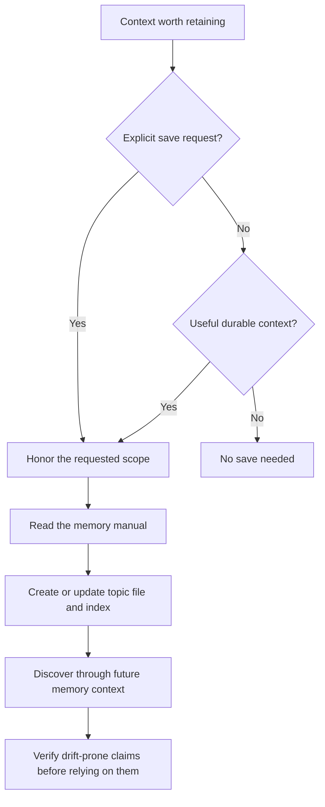

# Curated memory

## Memory flow



## Layout

```
.agents/memory/
  MEMORY.md             ; delivered index
  user-style.md         ; topic file
  issue-tracker.md      ; topic file
  external-systems.md   ; topic file
```

`MEMORY.md` is an index, not a body store. It is the only memory file
included in normal conversation context. Each configured root may
have its own `MEMORY.md`; the first 200 lines of every present index are
loaded in configured order and prefixed with the root label plus a
generated HTML comment describing the index file's last modification
date:

```markdown
<!-- Last updated: 2026-05-08 -->
- [User style](user-style.md) - communication preferences for this user
- [Issue tracker](issue-tracker.md) - where integration bugs are tracked
```

Topic files hold the actual durable memories. `MEMORY.md` entries should
stay short, usually one line under about 150 characters:

```markdown
- [Title](file.md) - one-line relevance hook
```

## Topic Files

Each topic file uses YAML frontmatter:

```markdown
---
name: User style
description: Communication and review preferences for this user
type: feedback
---

Prefer terse completion responses after code edits.

**Why:** the diff and tests already show most routine details.
**How to apply:** summarize material outcomes, risks, and verification
instead of replaying every edit.
```

Supported `type` values:

- `user`: stable details about the user's role, goals, expertise, or
  durable preferences.
- `feedback`: reusable guidance about how mevedel should approach work,
  including corrections and explicitly confirmed non-obvious approaches.
- `project`: enduring context or motivation not otherwise recoverable from
  code, Git history, project instructions, or maintained documentation.
- `reference`: otherwise undiscoverable pointers to authoritative information
  in trackers, documentation, or external systems, with their purpose.

Feedback and project memories should preserve enough context to be
actionable later. Prefer a direct rule or fact followed by `**Why:**`
and `**How to apply:**`.

## Save Policy

Ordinary saving is optional. Keep reusable knowledge in the categories above
when it will help a future task. No entry and no memory change are successful
outcomes. Do not treat an empty index as a task to fill, or infer a lasting
preference from silence or an ambiguous one-time reaction.

Tasks, blockers, deadlines, progress, and decisions belong in the project tracker
or maintained documentation. Conversation state and continuation details belong
in session context and compaction. Avoid speculative conclusions and duplication
of code, Git history, project instructions, or maintained documentation.
Debugging fix recipes normally stay with the code and commit; a distinct reusable
lesson may qualify, but the activity itself does not. A reference points to the
authoritative source instead of copying its changing contents. These defaults do
not veto an explicit request to preserve a particular fact. Avoid retaining
secrets or unnecessary personal information; keep the scope the user asked for.

Saving is a three-step operation:

1. Choose the correct memory root.
2. Create or update a topic file under that root.
3. Add or update the one-line pointer in that root's `MEMORY.md`.

Update existing memories in place. For new memories, use global memory
for cross-project user preferences or broad feedback, and local memory
for project-specific feedback, project context, or local references.
Prefer `.agents/memory/` for portable memories that other agent tools
can share. Use `.mevedel/memory/` for mevedel-specific behavior or
schema. Record known dates absolutely so relative wording does not drift.

When the user asks to remember something, save it within their selected scope
using the topic/index format. When they ask to forget, remove the relevant topic
content and pointer, preserving unrelated information. Do not invent an approval
gate solely because the requested fact is more ordinary than the default policy
would choose to save. A separately requested report-only review retains its
actual approval boundary.

## Prompt inclusion and delivery

The stable `memory-policy` owns relevance, authority, and freshness. The short
`memory-save-policy` requires reading this manual before any memory mutation,
including model-initiated saves. The manual owns format, routing, index updates,
and forget semantics; Read retrieves it as `mevedel://memory.md`.

Main and worker receive current configured roots and index contents as retained
context updates. Changed or removed indexes replace earlier observations for
current decisions without rewriting prior messages. Other role profiles receive
only the memory components they select. Stateless buddy prompts include their
current memory snapshot directly.

## Staleness

Memory is context, not proof. A memory that names a function, file,
command, flag, or external resource records what was believed when the
memory was written. Before recommending or acting on such a memory, the
model should cheaply verify it against current files, docs, git, or the
external system.

If the user says to ignore memory or not use memory, the model should
proceed as if `MEMORY.md` were empty. It should not apply remembered
facts, cite them, compare against them, or mention them.
